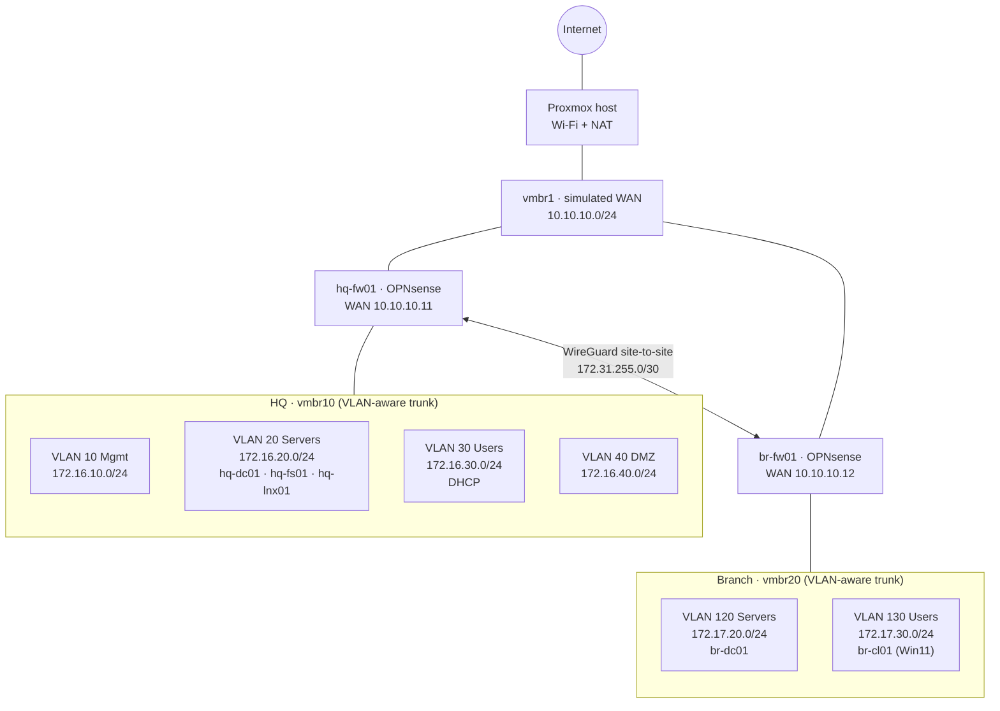

# Architecture

Two sites — **HQ** and **Branch** — each behind its own OPNsense firewall, joined by a WireGuard
site-to-site tunnel over a simulated Internet. One AD forest spans both sites.

## Topology



## Addressing

Supernets: **HQ 172.16.0.0/16**, **Branch 172.17.0.0/16**, **VPN 172.31.0.0/16**.
The third octet mirrors the VLAN purpose at both sites (x.20 = servers, x.30 = users), so a
route summary per site is enough and addresses are readable at a glance.

| Site | VLAN | Name | Subnet | Gateway | DHCP | Notes |
| --- | --- | --- | --- | --- | --- | --- |
| — | — | WAN (sim) | 10.10.10.0/24 | 10.10.10.1 (host NAT) | — | hq-fw01 .11, br-fw01 .12 |
| HQ | 10 | Mgmt | 172.16.10.0/24 | .1 | — | Firewall/hypervisor management, admin jump host |
| HQ | 20 | Servers | 172.16.20.0/24 | .1 | — | Static IPs only |
| HQ | 30 | Users | 172.16.30.0/24 | .1 | .100–.199 | Served by DC DHCP failover pair, relay on firewall |
| HQ | 40 | DMZ | 172.16.40.0/24 | .1 | — | Reserved for published services |
| HQ | 50 | Storage | 172.16.50.0/24 | — | — | Reserved: iSCSI (companion repo `hyperv-ha-dr-lab`), not routed |
| HQ | 60 | Live migration | 172.16.60.0/24 | — | — | Reserved: Hyper-V cluster, not routed |
| Branch | 120 | Servers | 172.17.20.0/24 | .1 | — | Static IPs only |
| Branch | 130 | Users | 172.17.30.0/24 | .1 | .100–.199 | DHCP relay to both DCs |
| VPN | — | Site-to-site | 172.31.255.0/30 | — | — | hq-fw01 .1, br-fw01 .2 |
| VPN | — | Remote access | 172.31.0.0/24 | — | — | WireGuard road-warrior peers |

### Static assignments

| Host | VMID | Site | IP | Role |
| --- | --- | --- | --- | --- |
| hq-fw01 | 101 | HQ | 10.10.10.11 / 172.16.x.1 | OPNsense, Unbound DNS forwarder, WireGuard |
| br-fw01 | 102 | Branch | 10.10.10.12 / 172.17.x.1 | OPNsense, WireGuard |
| hq-dc01 | 201 | HQ | 172.16.20.11 | AD DS, DNS, DHCP (failover primary), PDC emulator |
| br-dc01 | 202 | Branch | 172.17.20.11 | AD DS, DNS, DHCP (failover partner) |
| hq-fs01 | 211 | HQ | 172.16.20.21 | File server, DFS-N; iSCSI target later |
| hq-lnx01 | 221 | HQ | 172.16.20.61 | Ubuntu member server (realmd/sssd) |
| br-cl01 | 231 | Branch | DHCP | Windows 11 client |
| hq-adm01 | 241 | HQ | 172.16.10.10 | Admin jump host (optional) |

Reserved for companion repos: `3xx` Hyper-V/Veeam (`hyperv-ha-dr-lab`), `4xx` monitoring/ITSM (`infra-monitoring-itsm-lab`).

## Naming

- Hosts: `<site>-<role><nn>` in lowercase — `hq-dc01`, `br-fw01`. Site codes: `hq`, `br`.
- AD forest: **`corp.huylab.internal`** (NetBIOS `CORP`) — see ADR-0003.
- VMIDs: `1xx` network, `2xx` identity & services, `3xx` virtualization/backup, `4xx` operations, `9xxx` templates.
- Proxmox tags: `lab-core` (always on), `lab-branch`, `lab-ha`, `lab-ops`, plus `site-hq` / `site-br`.

## Templates (Packer)

| VMID | Template |
| --- | --- |
| 9001 | `tpl-ws2022-core` |
| 9002 | `tpl-ws2022-desktop` |
| 9003 | `tpl-win11-ent` |
| 9004 | `tpl-ubuntu-2404`: cloud image + qemu-guest-agent + updates, cloud-init clean (Packer `proxmox-clone`) |
| 9005 | `tpl-opnsense-26.7` (see ADR-0004) |
| 9100 | `base-ubuntu-2404-cloudimg`: unmodified cloud image (Terraform), source of 9004 |

## Firewall configuration

Both firewalls are managed as code (ADR-0004). Terraform creates the VMs
(`terraform/envs/lab/firewalls.tf`). Ansible renders and applies their full config from inventory
data (`ansible/inventory/host_vars/hq-fw01.yml`, `br-fw01.yml`):

```bash
scripts/ansible.sh playbooks/firewalls-render.yml   # review: render into ansible/build/, touch nothing
scripts/ansible.sh playbooks/firewalls.yml          # converge (reboots a firewall only if its config changed)
scripts/ansible.sh playbooks/firewalls-export.yml   # sanitized running config -> docs/network/opnsense/
scripts/fw-policy-test.sh                           # prove the policy with real traffic (~8 min)
```

`scripts/fw-policy-test.sh` creates one Ubuntu probe per VLAN (`terraform/envs/fw-test`), runs every
case of `tests/firewall/policy.yml` through the Proxmox guest agent (allow = connection or reply,
deny = timeout, every target port has a listener), writes
[`docs/network/policy-test-report.md`](network/policy-test-report.md) and destroys the probes.

On each firewall, `vtnet0` is the site trunk (VLAN parent, no address) and `vtnet1` is the WAN.
VLAN interfaces are `opt1..optN` in `opnsense_vlans` order.

## Active Directory

`scripts/ansible.sh playbooks/ad.yml` builds and verifies the forest (role `ansible/roles/ad_ds`,
pitfalls in its README). The last run's result: [`docs/ad/health-report.md`](ad/health-report.md).

| | hq-dc01 | br-dc01 |
| --- | --- | --- |
| Site | HQ (172.16.0.0/16) | BRANCH (172.17.0.0/16) |
| Roles | all FSMO, GC, DNS | GC, DNS |
| DNS forwarder | hq-fw01 (Unbound) | br-fw01 (Unbound) |
| Resolver order | br-dc01, self | hq-dc01, self |
| Time | hq-fw01 NTP (PDC) | domain hierarchy |

### DHCP

Both DCs serve both Users scopes as a load-balance failover pair (`HQ-BRANCH-DHCP`, role
`ansible/roles/dhcp`); each firewall relays its Users VLAN to both. Either DC can be down:
[`docs/dhcp/failover-test-report.md`](dhcp/failover-test-report.md).

| Scope | Range | Router | DNS (option 6) |
| --- | --- | --- | --- |
| HQ-Users 172.16.30.0/24 | .100-.199 | 172.16.30.1 | hq-dc01, br-dc01 |
| Branch-Users 172.17.30.0/24 | .100-.199 | 172.17.30.1 | br-dc01, hq-dc01 |

## VPN (ADR-0005)

| Tunnel | Where | Port | Addresses | Carries |
| --- | --- | --- | --- | --- |
| Site-to-site `wg0` | hq-fw01 <-> br-fw01 | UDP 51820 (peer WAN only) | 172.31.255.1/30 - .2 | HQ <-> Branch, plus the VPN pool towards Branch; PSK on top of the keys |
| Remote access `wg1` | hq-fw01 | UDP 51821 (whole WAN) | 172.31.0.1/24, admin01 .10 | Admins to Mgmt/Servers at both sites (split tunnel) |

Client configs are rendered to `ansible/build/wireguard/<peer>.conf` by
`scripts/ansible.sh playbooks/firewalls-render.yml` (they hold a private key: never committed).
Keys live in `~/.config/lab/secrets.json` (`scripts/lab-secrets.sh`).

## Security baseline

- Inter-VLAN traffic is **deny by default**; each allowed flow is an explicit rule
  (e.g. Users → DCs: DNS 53, Kerberos 88, LDAP 389/636, SMB 445, RPC 135 + dynamic range).
- Management VLAN reachable only from the admin host (10.10.10.1) and the VPN remote-access pool.
- DNS: clients → DCs → OPNsense Unbound → upstream. No client talks to the Internet DNS directly.
- Time: hq-dc01 (PDC emulator) syncs from OPNsense NTP; all domain members follow the domain hierarchy.

## Admin access path

Automation runs on the Proxmox host. The host reaches lab subnets through static routes added once
(`172.16.0.0/16 via 10.10.10.11`, `172.17.0.0/16 via 10.10.10.12`, persisted in
`/etc/network/interfaces` as `post-up` lines on `vmbr1`), and each firewall's WAN rules allow only
`10.10.10.1` to reach the Mgmt and Servers VLANs (WinRM 5986, SSH 22, HTTPS 443).

## Resource budget

Host: 16 threads, 23 GB RAM (≈ 19 GB usable for guests), 374 GB LVM-thin.

| Profile | VMs | vCPU | RAM | Disk (thin, used) |
| --- | --- | --- | --- | --- |
| `lab-core` | hq-fw01, hq-dc01, hq-fs01 | 2 + 2 + 2 | 1 + 2.5 + 2 GB | ~45 GB |
| `lab-branch` | br-fw01, br-dc01, br-cl01 | 1 + 2 + 2 | 1 + 2 + 3 GB | ~50 GB |
| extras | hq-lnx01, hq-adm01 | 1 + 2 | 1 + 2 GB | ~25 GB |
| **This repo total** | | 17 (overcommit OK) | **≈ 16.5 GB** | ~120 GB + templates ~40 GB |

Companion repos run with `lab-branch` and extras stopped (`scripts/lab-profile.sh`, added later).
